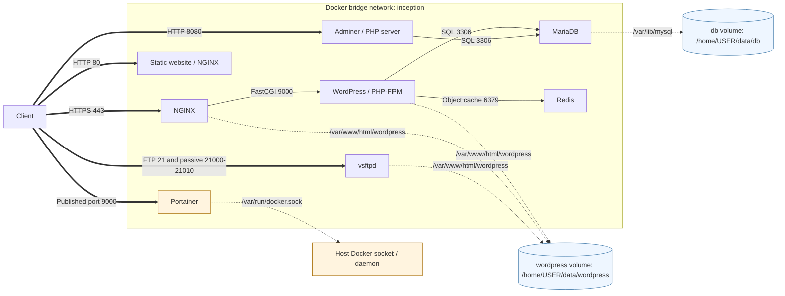
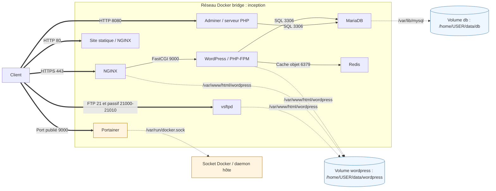

*Developed as part of the École 42 Paris curriculum.*

# Inception

**A containerized web infrastructure built from custom Debian-based images: HTTPS, WordPress, MariaDB and five integrated services, orchestrated with Docker Compose.**

[English](#english) | [Français](#francais)

<!-- Future demonstration: add inception.gif at the repository root, then replace this comment with . -->
---

<a id="english"></a>
## English

[Project Context](#en-context) · [Overview](#en-overview) · [Features](#en-features) · [Engineering Highlights](#en-engineering) · [Architecture](#en-architecture) · [Getting Started](#en-start) · [Usage Examples](#en-examples)

<a id="en-context"></a>
### 1. Project Context

Inception belongs to the École 42 Paris common core curriculum, a project-based, peer-learning programme. Its objective is to **design, configure and orchestrate a containerized web infrastructure** inside a Linux virtual machine.

The project connects Linux system administration, custom Docker image construction, Docker Compose orchestration, inter-service networking, data persistence and HTTPS web serving. Configuration, credentials, process lifecycles and service dependencies must work together across independently running containers.

This repository does not simply launch preconfigured application images. Each of its eight services has a Dockerfile based on `debian:bookworm`; packages, configuration files and startup commands assemble the infrastructure. The core stack separates NGINX, WordPress with PHP-FPM, and MariaDB, then extends it with caching, file transfer and administration services.

<a id="en-overview"></a>
### 2. Overview

NGINX accepts WordPress traffic over HTTPS, serves its static resources and forwards PHP requests to PHP-FPM in the `wordpress` container. WordPress executes the application and stores its relational data in `mariadb`. These services share a Compose-defined bridge network and resolve one another by service name.

Five bonus services extend the stack: `redis` provides a WordPress object-cache backend, `ftp` exposes the WordPress files through vsftpd, `website` serves a separate static HTML/CSS page, `adminer` provides a database interface, and `portainer` supplies a Docker administration interface with access to the host Docker socket.

The central engineering challenge is coordinating **network boundaries, initialization order and persistent state**. Application files are shared by NGINX, WordPress and FTP, while database storage has its own volume. The static site and administration interfaces have independent published ports: they do **not** pass through the HTTPS NGINX container.

<a id="en-features"></a>
### 3. Features

**Mandatory services**

| Compose service | Technology | Responsibility | Infrastructure capability |
|---|---|---|---|
| `nginx` | NGINX + OpenSSL | HTTPS entry point and static-file serving | TLS 1.2/1.3 on host port `443`; FastCGI dispatch to WordPress |
| `wordpress` | WordPress + PHP-FPM 8.2 + WP-CLI | PHP application execution and provisioning | Site installation, administrator and author creation; internal port `9000` |
| `mariadb` | MariaDB | Relational data storage | Application database and scoped database user; internal port `3306` |

**Bonus services**

| Compose service | Technology | Responsibility | Infrastructure capability |
|---|---|---|---|
| `redis` | Redis + WordPress Redis Object Cache plugin | Object-cache backend | Internal port `6379`, `256mb` memory limit and `allkeys-lru` eviction |
| `ftp` | vsftpd | File transfer to the shared WordPress directory | Local-user login, chroot and writable access; host ports `21` and `21000–21010` |
| `website` | Separate NGINX instance + HTML/CSS | Independent static website | Direct HTTP access on host port `80` |
| `adminer` | Adminer 4.8.1 + PHP built-in server | Database administration | Direct HTTP access on host port `8080`, connection to `mariadb` |
| `portainer` | Portainer 2.21.5 | Docker administration | Host port `9000` published; Docker socket mounted into the container |

| Area | Implemented scope |
|---|---|
| Image construction | Eight service-specific Debian Bookworm Dockerfiles; distribution packages and selected upstream downloads |
| Orchestration | All eight services built and started by the same Compose file; `restart: unless-stopped` on each |
| Networking | One bridge network, `inception`; service-name DNS; no host publication for MariaDB, PHP-FPM or Redis |
| Persistence | Two named volumes using local-driver bind options under `/home/${USER}/data` |
| HTTPS | Self-signed RSA-2048 certificate generated at NGINX startup; TLS 1.2 and 1.3 |
| Provisioning | Shell entrypoints, database availability polling and WP-CLI setup; existing-data guards for MariaDB and WordPress |
| Configuration | Local, Git-ignored `srcs/.env` loaded by selected services; credentials are environment variables, not Docker secrets |

Sources: [Compose topology](srcs/docker-compose.yml), [Makefile](Makefile).

<a id="en-engineering"></a>
### 4. Engineering Highlights

#### Building service-specific images and handing control to the daemon

Each service needs its own dependencies and runtime configuration without relying on a preconfigured WordPress, MariaDB or NGINX application image. All eight Dockerfiles start from **Debian Bookworm**, install the required packages with APT and remove the package indexes. Configuration is copied from each service's `conf/` directory; services requiring provisioning also copy `tools/init.sh` as an entrypoint.

The WordPress image installs PHP extensions, a database client for availability polling, and WP-CLI 2.11.0. WordPress itself is downloaded at initialization, not baked into the image. Adminer 4.8.1 and Portainer 2.21.5 are downloaded during image construction; Portainer selects its release archive with `dpkg --print-architecture`. These choices make the distinction between **image build time and data-dependent startup** explicit; WordPress core and its Redis plugin are not version-pinned by the scripts.

The shell entrypoints finish with `exec`: `mysqld --user=mysql`, `php-fpm8.2 -F`, `nginx -g "daemon off;"`, vsftpd or Portainer replaces the shell. Redis, the static-site NGINX and Adminer's PHP server use direct foreground `CMD` instructions. The main process therefore stays attached to the container lifecycle rather than being kept alive by an unrelated loop. PHP-FPM uses a dynamic pool of at most five `www-data` workers.

Sources: [NGINX Dockerfile](srcs/requirements/nginx/Dockerfile), [WordPress Dockerfile](srcs/requirements/wordpress/Dockerfile), [MariaDB Dockerfile](srcs/requirements/mariadb/Dockerfile), [PHP-FPM pool](srcs/requirements/wordpress/conf/www.conf), [Adminer Dockerfile](srcs/requirements/bonus/adminer/Dockerfile), [Portainer Dockerfile](srcs/requirements/bonus/portainer/Dockerfile), [Redis Dockerfile](srcs/requirements/bonus/redis/Dockerfile), [FTP Dockerfile](srcs/requirements/bonus/ftp/Dockerfile), [static-site Dockerfile](srcs/requirements/bonus/website/Dockerfile).

#### Routing HTTPS through shared files and FastCGI, not an HTTP proxy

A PHP site needs both a web-facing server and a PHP execution backend. Here, NGINX and PHP-FPM see the **same WordPress volume at the same absolute path**, `/var/www/html/wordpress`. NGINX can serve assets directly and construct a valid `SCRIPT_FILENAME` for PHP-FPM without copying application files between containers.

The request path is `client → host:443 → nginx → wordpress:9000 → mariadb:3306`, with Redis available at `redis:6379` for object caching. Docker's service-name DNS supplies the internal destinations. NGINX's `try_files` first looks for a file or directory, then falls back to `/index.php?$args`; PHP locations use `fastcgi_pass wordpress:9000` and pass the script path and FastCGI parameters. This is **FastCGI gatewaying**, not an HTTP `proxy_pass` reverse proxy.

At every NGINX startup, OpenSSL generates a self-signed, 365-day RSA-2048 certificate whose CN comes from `DOMAIN_NAME`. The server accepts TLS 1.2/1.3 and uses `server_name _`, not a domain-substituted virtual host. The certificate is not mounted persistently and is regenerated even on a container restart. The static site's separate port `80` is not an HTTP-to-HTTPS redirect.

Only declared `ports` mappings publish services on the host. PHP-FPM's internal `9000` and Portainer's host `9000` are separate endpoints and do not conflict. Dockerfile `EXPOSE` is metadata, not publication: Portainer's declared `8000`, for example, has no host mapping. All services share one bridge; this is not per-service network segmentation or an `internal: true` network.

Sources: [NGINX configuration](srcs/requirements/nginx/conf/nginx.conf), [certificate generation and startup](srcs/requirements/nginx/tools/init.sh), [Compose network and ports](srcs/docker-compose.yml), [static-site server configuration](srcs/requirements/bonus/website/Dockerfile).

#### Separating container replacement from application data

Recreating an application container should not discard the database or uploaded files. Compose defines two named volumes with the local driver's `type: none`, `o: bind` options: `db` maps `/home/${USER}/data/db` to `/var/lib/mysql`, and `wordpress` maps `/home/${USER}/data/wordpress` to `/var/www/html/wordpress`.

The database volume belongs only to MariaDB. The WordPress volume contains core files, configuration, plugins and uploads, and is mounted into WordPress, NGINX and FTP. **All three mounts are writable**; the NGINX mount is not marked read-only. FTP's entrypoint recursively assigns the shared directory to its local FTP user, so shared numeric ownership and application write permissions matter across containers.

These host-backed directories survive restarts, container replacement and `make down`. The arrangement combines Docker volume names with an explicit host layout; it is not host-path-independent storage. Other state has no explicit persistent volume in Compose: Redis cache contents, Portainer configuration and generated TLS material are not covered by these two data mounts. In particular, mounting the Docker socket does not persist Portainer's own configuration.

Sources: [volume definitions and mounts](srcs/docker-compose.yml), [data-directory creation and deletion](Makefile), [FTP ownership setup](srcs/requirements/bonus/ftp/tools/init.sh).

#### Bootstrapping stateful services with availability polling and existing-data guards

Container start order is not application readiness. Compose declares `wordpress → mariadb`, `adminer → mariadb` and `nginx → wordpress` through `depends_on`; it does not define healthchecks or readiness conditions. The WordPress entrypoint adds its own `mysqladmin ping` loop against `mariadb` before running WP-CLI. This checks database-server availability, not successful completion of the whole application setup.

MariaDB checks for `/var/lib/mysql/${MYSQL_DATABASE}`. When absent, it initializes the data directory, starts a temporary server, waits for a local ping, creates the database and a user granted privileges on that database, and sets the local root password. It then terminates and waits for the temporary process before `exec`-starting the final server. When the directory exists, that provisioning block is skipped.

WordPress checks for `wp-config.php`. When absent, WP-CLI downloads core, writes the database connection with `dbhost=mariadb`, installs the site using `DOMAIN_NAME`, creates the administrator, then adds a second user with the `author` role. Redis plugin activation and cache enablement run **on every startup**, outside that guard. Redis is not a declared WordPress startup dependency and has no dedicated readiness wait.

The guards preserve an existing installation, but they are not transactional recovery: these scripts do not enable fail-fast shell handling, and a partially created configuration can satisfy the next startup's guard. Likewise, changing `.env` credentials alone does not reprovision existing database or WordPress accounts. This distinction between initial provisioning and ongoing configuration is essential when operating persistent services.

Sources: [MariaDB initialization](srcs/requirements/mariadb/tools/init.sh), [WordPress initialization](srcs/requirements/wordpress/tools/init.sh), [Compose dependencies and restart policies](srcs/docker-compose.yml).

#### Integrating bonus services at the appropriate boundary

The bonus services extend different layers rather than sharing a single proxy route. WordPress installs and activates `redis-cache`, writes `WP_REDIS_HOST=redis`, then runs `wp redis enable`. Redis listens on the bridge network, limits memory to `256mb` and evicts any key using LRU when necessary. It has no persistent volume: this integration is a cache layer, not the authoritative application database.

FTP operates on the **same files**, not through the WordPress HTTP interface. Its startup creates a local account and sets its password from the environment. vsftpd disables anonymous access, chroots local users and allows writes, with passive transfers on ports `21000–21010`. These ports are published alongside control port `21`; FTP TLS is not configured, and VM/NAT deployment requires a reachable passive-data path.

Adminer is served by PHP's built-in HTTP server on `8080` and can reach `mariadb` by its network name using credentials entered in the interface. Portainer's entrypoint hashes its initial administrator password with bcrypt through `htpasswd`, then launches the binary with `--admin-password`. Its Docker socket mount gives it access to the host daemon; the local Docker environment may still need selection or configuration in the UI. Neither service is behind the WordPress TLS endpoint. The independent static page is copied into a separate NGINX image and served on `80`.

Sources: [WordPress cache integration](srcs/requirements/wordpress/tools/init.sh), [Redis configuration](srcs/requirements/bonus/redis/conf/redis.conf), [vsftpd configuration](srcs/requirements/bonus/ftp/conf/vsftpd.conf), [FTP initialization](srcs/requirements/bonus/ftp/tools/init.sh), [Adminer server](srcs/requirements/bonus/adminer/Dockerfile), [Portainer password initialization](srcs/requirements/bonus/portainer/tools/init.sh), [static page](srcs/requirements/bonus/website/conf/index.html), [published ports and socket mount](srcs/docker-compose.yml).

#### Keeping configuration external while making trust boundaries explicit

Runtime credentials live in local `srcs/.env`, excluded by `.gitignore`. Compose passes that whole file to MariaDB, WordPress, FTP, Portainer and NGINX through `env_file`; it does not filter credentials per service. Compose also interpolates `${USER}` into volume host paths. **Environment-based configuration is not Docker secrets**, and the generated `wp-config.php` stores the database connection in the persistent WordPress directory accessible through its shared mounts.

There are concrete access boundaries: MariaDB is not host-published and its application user is scoped to one database; PHP-FPM workers run as `www-data`; FTP rejects anonymous users and confines local sessions to their home directory. Those choices do not make the stack production-hardened. MariaDB listens on `0.0.0.0`, its application account permits connections from `%`, and Redis has `protected-mode no` with no password configured. All containers on the shared bridge can reach these listeners; internal application connections have no TLS configuration in the repository.

Host port mappings specify no loopback-only binding, so their reachability also depends on the VM, host network and firewall. The auxiliary HTTP/FTP endpoints are not protected by NGINX TLS, and Docker socket access is a host-level administrative privilege. This is a **pedagogical infrastructure with explicit trust assumptions**, not a claim of production security.

Sources: [environment exclusion](.gitignore), [environment distribution and network exposure](srcs/docker-compose.yml), [MariaDB listener](srcs/requirements/mariadb/conf/50-server.cnf), [database grants](srcs/requirements/mariadb/tools/init.sh), [PHP-FPM users](srcs/requirements/wordpress/conf/www.conf), [Redis access configuration](srcs/requirements/bonus/redis/conf/redis.conf), [FTP access configuration](srcs/requirements/bonus/ftp/conf/vsftpd.conf).

<a id="en-architecture"></a>
### 5. Architecture

The diagram represents configured communication paths, not healthcheck or startup dependencies. **Thick arrows** are host-published client access, **thin arrows** are internal service communications, and **dotted links** are filesystem mounts. The Docker socket is an administrative mount, not application storage.



`USER` in the diagram is the host account used for Compose interpolation. Volume and network engine names can be project-prefixed; `db`, `wordpress` and `inception` are their Compose keys. Bonus services are included in the normal stack, without a separate profile or Make target.

```text
Makefile                              Build/start/stop and destructive cleanup targets
srcs/docker-compose.yml               Services, dependencies, ports, network and volumes
srcs/.env                             Local runtime configuration; ignored by Git
srcs/requirements/
├── nginx/                            Dockerfile, conf/nginx.conf, tools/init.sh
├── wordpress/                        Dockerfile, conf/www.conf, tools/init.sh
├── mariadb/                          Dockerfile, conf/50-server.cnf, tools/init.sh
└── bonus/
    ├── redis/                        Dockerfile and conf/redis.conf
    ├── ftp/                          Dockerfile, conf/vsftpd.conf, tools/init.sh
    ├── website/                      Dockerfile and conf/index.html
    ├── adminer/                      Dockerfile with download and HTTP server command
    └── portainer/                    Dockerfile and tools/init.sh
USER_DOC.md                           Service access and day-to-day operations
DEV_DOC.md                            Developer setup and initialization reference
```

Start with [Compose](srcs/docker-compose.yml) for topology, then follow each Dockerfile into its `conf/` and `tools/` files. The [Makefile](Makefile) controls host-side operations; provisioning happens inside the service entrypoints.

<a id="en-start"></a>
### 6. Getting Started

**Requirements:** a Debian 12 (Bookworm) Linux VM, Docker Engine, Make, Git and the `docker-compose` command used literally by the Makefile. A Compose V2 installation exposing only `docker compose` is not sufficient for these Make targets without a compatible command wrapper. Network access is required for base images, packages, upstream binaries and WordPress/plugin downloads.

On a Debian VM, install the documented dependencies and ensure Docker is running:

```bash
sudo apt update
sudo apt install docker.io docker-compose make git curl
sudo systemctl enable --now docker
docker-compose --version
```

Use an account authorized to access the Docker daemon. If using the `docker` group, remember that membership grants host-level privileges; reconnect after adding your account as described in [DEV_DOC.md](DEV_DOC.md).

```bash
git clone https://github.com/adecauch/inception.git
cd inception
export USER="$(id -un)"
```

**Local configuration** — create `srcs/.env` yourself, with restricted access, using the following template. Replace every `<...>` placeholder with a local value; never commit credentials. The WordPress administrator name must not contain `admin` or `administrator`, as required by the project setup documentation.

```dotenv
MYSQL_DATABASE=<database_name>
MYSQL_USER=<database_user>
MYSQL_PASSWORD=<database_password>
MYSQL_ROOT_PASSWORD=<database_root_password>
DOMAIN_NAME=adecauch.42.fr
WP_ADMIN_USER=<site_manager_name>
WP_ADMIN_PASSWORD=<site_manager_password>
WP_ADMIN_EMAIL=<site_manager_email>
WP_USER=<author_name>
WP_USER_EMAIL=<author_email>
WP_USER_PASSWORD=<author_password>
FTP_USER=<ftp_user>
FTP_PASSWORD=<ftp_password>
PORTAINER_PASSWORD=<dashboard_password>
```

```bash
chmod 600 srcs/.env
```

**Domain resolution** — add `adecauch.42.fr` to `/etc/hosts` on each machine running a client. Inside the VM, use `127.0.0.1`; from another machine, use the VM's reachable IP, or `127.0.0.1` only if the necessary VM port forwarding is configured. Keep `DOMAIN_NAME` and the client hostname consistent.

```text
127.0.0.1 adecauch.42.fr
```

**Data directories and startup** — the Makefile and Compose both use `/home/$USER/data`. Keep the same exported `USER` for all commands and ensure that host directory is writable by your account. If it needs privileged creation:

```bash
sudo mkdir -p "/home/$USER/data"
sudo chown "$(id -u):$(id -g)" "/home/$USER/data"
make
```

`make` creates the `db/` and `wordpress/` subdirectories, then runs `docker-compose -f srcs/docker-compose.yml up -d --build` for all eight services. First initialization also downloads WordPress and its cache plugin. Startup commands do not constitute an application-level readiness check; inspect logs before using the site.

| Command | Actual effect |
|---|---|
| `make` | Build and start the full stack in the background; retain existing data |
| `make stop` | Stop containers without removing them; **not** a Docker pause |
| `make down` | Stop/remove stack containers and its network; retain the data directories and named volumes |
| `make clean` | Run `down`, then daemon-wide `docker system prune -f`, then delete `/home/$(USER)/data` through `su -c` |
| `make fclean` | Run `clean`, then daemon-wide `docker system prune -af --volumes` |
| `make re` | Run `fclean`, then build/start again: **a destructive reset, not a normal restart** |

**Destructive cleanup:** `clean`, `fclean` and `re` can erase the database and WordPress files. The prune commands are not scoped to this repository and may remove unused resources from other Docker projects; `su -c` may require the root password. Back up required data first. Use `down` or `stop` for normal shutdown, not a cleanup target.

See [USER_DOC.md](USER_DOC.md) for operational guidance and [DEV_DOC.md](DEV_DOC.md) for developer setup. The table above follows the actual Makefile, including the scope of pruning and the distinction between stopping and pausing.

Further references: [Docker](https://docs.docker.com/), [Compose](https://docs.docker.com/compose/), [NGINX](https://nginx.org/en/docs/), [MariaDB](https://mariadb.com/kb/en/), [WordPress](https://developer.wordpress.org/), [WP-CLI](https://wp-cli.org/), [PHP-FPM](https://www.php.net/manual/en/install.fpm.php), [Redis](https://redis.io/docs/), [vsftpd](https://security.appspot.com/vsftpd.html), [Portainer](https://docs.portainer.io/).

<a id="en-examples"></a>
### 7. Usage Examples

Run these commands from the repository root, after completing local configuration.

**Build, start and inspect the stack:**

```bash
make
docker-compose -f srcs/docker-compose.yml ps
docker-compose -f srcs/docker-compose.yml logs --tail=100 mariadb wordpress nginx
docker-compose -f srcs/docker-compose.yml logs -f redis ftp website adminer portainer
```

Use Ctrl-C to leave log following; it does not stop the containers. An `Up` status alone does not confirm that application initialization succeeded.

**Open the services** — with the hostname resolving to the VM:

| Address | Use |
|---|---|
| `https://adecauch.42.fr` | WordPress website |
| `https://adecauch.42.fr/wp-admin` | WordPress administration; use your configured `WP_ADMIN_*` account |
| `http://adecauch.42.fr` | Independent static website |
| `http://adecauch.42.fr:8080/adminer.php` | Adminer; choose MySQL and server `mariadb`, then your configured `MYSQL_*` values |
| `http://adecauch.42.fr:9000` | Published Portainer interface; use the locally configured dashboard password |
| `ftp://adecauch.42.fr` | Passive-mode FTP client using your `FTP_*` account; WordPress directory is the FTP root |

The WordPress certificate is self-signed: a browser trust warning is expected. For a local HTTPS connectivity check, `curl -k` bypasses certificate verification explicitly; it does not validate certificate trust:

```bash
curl -kI https://adecauch.42.fr
```

**Inspect the configured cache integration** — run after WordPress initialization:

```bash
docker-compose -f srcs/docker-compose.yml exec wordpress \
    wp redis status --path=/var/www/html/wordpress --allow-root
```

**Stop, resume or recreate without intentionally deleting application data:**

```bash
make stop
docker-compose -f srcs/docker-compose.yml start
docker-compose -f srcs/docker-compose.yml restart
make down
make
```

`start` resumes existing stopped containers; `restart` reruns their startup scripts without rebuilding images or applying changed Compose environment settings. `down` followed by `make` recreates containers while keeping the two host-backed data directories. Existing database and WordPress credentials still follow the initialization guards described above; other container-local state is not covered by those volumes.

---

<a id="francais"></a>
## Français

[Contexte du projet](#fr-contexte) · [Présentation](#fr-presentation) · [Fonctionnalités](#fr-fonctionnalites) · [Points techniques](#fr-technique) · [Architecture](#fr-architecture) · [Installation et lancement](#fr-installation) · [Exemples](#fr-exemples)

<a id="fr-contexte"></a>
### 1. Contexte du projet

Inception s'inscrit dans le tronc commun de l'École 42 Paris, une formation par projets et apprentissage entre pairs. Son objectif est de **concevoir, configurer et orchestrer une infrastructure web conteneurisée** au sein d'une machine virtuelle Linux.

Le projet relie administration système Linux, construction d'images Docker personnalisées, orchestration avec Docker Compose, communication réseau entre services, persistance des données et configuration d'un serveur web HTTPS. Configuration, identifiants, cycles de vie des processus et dépendances doivent fonctionner ensemble dans des conteneurs indépendants.

Ce dépôt ne se contente pas de lancer des images applicatives préconfigurées. Chacun de ses huit services possède un Dockerfile basé sur `debian:bookworm` ; les paquets, fichiers de configuration et commandes de démarrage composent l'infrastructure. Le socle sépare NGINX, WordPress avec PHP-FPM et MariaDB, puis intègre des services de cache, de transfert de fichiers et d'administration.

<a id="fr-presentation"></a>
### 2. Présentation

NGINX reçoit le trafic WordPress en HTTPS, sert ses ressources statiques et transmet les requêtes PHP à PHP-FPM dans le conteneur `wordpress`. WordPress exécute l'application et stocke ses données relationnelles dans `mariadb`. Ces services partagent un réseau bridge défini dans Compose et se joignent par leur nom de service.

Cinq services bonus enrichissent cette architecture : `redis` fournit un backend de cache objet pour WordPress, `ftp` expose les fichiers WordPress avec vsftpd, `website` sert une page HTML/CSS statique indépendante, `adminer` fournit une interface de gestion de base de données et `portainer` apporte une interface d'administration Docker avec accès au socket Docker de l'hôte.

La difficulté technique centrale est de coordonner **frontières réseau, ordre d'initialisation et état persistant**. Les fichiers applicatifs sont partagés entre NGINX, WordPress et FTP, tandis que la base de données dispose de son propre volume. Le site statique et les interfaces d'administration possèdent leurs propres ports publiés : ils ne passent **pas** par le conteneur NGINX HTTPS.

<a id="fr-fonctionnalites"></a>
### 3. Fonctionnalités

**Services obligatoires**

| Service Compose | Technologie | Responsabilité | Fonctionnalité apportée |
|---|---|---|---|
| `nginx` | NGINX + OpenSSL | Point d'entrée HTTPS et distribution des fichiers statiques | TLS 1.2/1.3 sur le port hôte `443` ; transmission FastCGI vers WordPress |
| `wordpress` | WordPress + PHP-FPM 8.2 + WP-CLI | Exécution PHP et provisionnement applicatif | Installation du site, création d'un administrateur et d'un auteur ; port interne `9000` |
| `mariadb` | MariaDB | Stockage des données relationnelles | Base applicative et utilisateur aux droits limités à cette base ; port interne `3306` |

**Services bonus**

| Service Compose | Technologie | Responsabilité | Fonctionnalité apportée |
|---|---|---|---|
| `redis` | Redis + plugin WordPress Redis Object Cache | Backend de cache objet | Port interne `6379`, limite mémoire de `256mb` et éviction `allkeys-lru` |
| `ftp` | vsftpd | Transfert de fichiers vers le répertoire WordPress partagé | Authentification locale, chroot et accès en écriture ; ports hôte `21` et `21000–21010` |
| `website` | Instance NGINX distincte + HTML/CSS | Site statique indépendant | Accès HTTP direct sur le port hôte `80` |
| `adminer` | Adminer 4.8.1 + serveur PHP intégré | Administration de la base de données | Accès HTTP direct sur le port hôte `8080`, connexion à `mariadb` |
| `portainer` | Portainer 2.21.5 | Administration Docker | Port hôte `9000` publié ; socket Docker monté dans le conteneur |

| Domaine | Périmètre implémenté |
|---|---|
| Construction des images | Huit Dockerfiles Debian Bookworm propres aux services ; paquets de distribution et téléchargements upstream ciblés |
| Orchestration | Huit services construits et démarrés par le même fichier Compose ; `restart: unless-stopped` pour chacun |
| Réseau | Un réseau bridge, `inception` ; DNS par nom de service ; aucun port hôte publié pour MariaDB, PHP-FPM ou Redis |
| Persistance | Deux volumes nommés utilisant les options de bind du driver local sous `/home/${USER}/data` |
| HTTPS | Certificat RSA-2048 auto-signé généré au démarrage de NGINX ; TLS 1.2 et 1.3 |
| Provisionnement | Entrypoints shell, attente de disponibilité de la base et configuration WP-CLI ; gardes sur les données existantes pour MariaDB et WordPress |
| Configuration | `srcs/.env` local, ignoré par Git, chargé par certains services ; identifiants transmis par variables d'environnement, pas par Docker secrets |

Sources : [topologie Compose](srcs/docker-compose.yml), [Makefile](Makefile).

<a id="fr-technique"></a>
### 4. Points techniques

#### Construire des images spécialisées et transmettre le contrôle au daemon

Chaque service doit disposer de ses dépendances et de sa configuration d'exécution sans reposer sur une image applicative WordPress, MariaDB ou NGINX préconfigurée. Les huit Dockerfiles partent de **Debian Bookworm**, installent les paquets nécessaires avec APT et suppriment les index des paquets. La configuration est copiée depuis le dossier `conf/` de chaque service ; les services nécessitant un provisionnement copient aussi `tools/init.sh` comme entrypoint.

L'image WordPress installe les extensions PHP, un client de base de données pour l'attente de disponibilité et WP-CLI 2.11.0. WordPress lui-même est téléchargé à l'initialisation, et non intégré à l'image. Adminer 4.8.1 et Portainer 2.21.5 sont téléchargés pendant la construction ; Portainer sélectionne son archive avec `dpkg --print-architecture`. Ces choix rendent explicite la distinction entre **construction de l'image et démarrage dépendant des données** ; les scripts ne fixent pas de version pour le cœur WordPress ni pour son plugin Redis.

Les entrypoints shell se terminent par `exec` : `mysqld --user=mysql`, `php-fpm8.2 -F`, `nginx -g "daemon off;"`, vsftpd ou Portainer remplace le shell. Redis, le NGINX du site statique et le serveur PHP d'Adminer utilisent directement des instructions `CMD` au premier plan. Le processus principal reste ainsi lié au cycle de vie du conteneur, sans boucle artificielle destinée à le maintenir actif. PHP-FPM utilise un pool dynamique d'au plus cinq workers `www-data`.

Sources : [Dockerfile NGINX](srcs/requirements/nginx/Dockerfile), [Dockerfile WordPress](srcs/requirements/wordpress/Dockerfile), [Dockerfile MariaDB](srcs/requirements/mariadb/Dockerfile), [pool PHP-FPM](srcs/requirements/wordpress/conf/www.conf), [Dockerfile Adminer](srcs/requirements/bonus/adminer/Dockerfile), [Dockerfile Portainer](srcs/requirements/bonus/portainer/Dockerfile), [Dockerfile Redis](srcs/requirements/bonus/redis/Dockerfile), [Dockerfile FTP](srcs/requirements/bonus/ftp/Dockerfile), [Dockerfile du site statique](srcs/requirements/bonus/website/Dockerfile).

#### Acheminer le HTTPS avec des fichiers partagés et FastCGI, sans proxy HTTP

Un site PHP nécessite à la fois un serveur exposé au client et un backend d'exécution PHP. Ici, NGINX et PHP-FPM voient le **même volume WordPress au même chemin absolu**, `/var/www/html/wordpress`. NGINX peut servir directement les ressources et construire un `SCRIPT_FILENAME` valide pour PHP-FPM sans copier les fichiers applicatifs entre conteneurs.

Le chemin d'une requête est `client → hôte:443 → nginx → wordpress:9000 → mariadb:3306`, avec Redis disponible à `redis:6379` pour le cache objet. Le DNS Docker par nom de service fournit les destinations internes. La directive `try_files` de NGINX recherche d'abord un fichier ou un répertoire, puis utilise `/index.php?$args` en repli ; les emplacements PHP utilisent `fastcgi_pass wordpress:9000` et transmettent le chemin du script et les paramètres FastCGI. Il s'agit d'une **passerelle FastCGI**, et non d'un reverse proxy HTTP avec `proxy_pass`.

À chaque démarrage de NGINX, OpenSSL génère un certificat RSA-2048 auto-signé de 365 jours, dont le CN provient de `DOMAIN_NAME`. Le serveur accepte TLS 1.2/1.3 et utilise `server_name _`, pas un virtual host substitué avec le domaine. Le certificat n'est pas monté de manière persistante et est régénéré même lors d'un redémarrage du conteneur. Le port `80` du site statique distinct n'effectue pas de redirection HTTP vers HTTPS.

Seules les entrées `ports` publient des services sur l'hôte. Le `9000` interne de PHP-FPM et le `9000` hôte de Portainer sont des points d'accès distincts, sans conflit. L'instruction Dockerfile `EXPOSE` est une métadonnée, pas une publication : le `8000` déclaré par Portainer n'a par exemple aucun mapping hôte. Tous les services partagent un bridge ; ce n'est ni une segmentation réseau par service ni un réseau `internal: true`.

Sources : [configuration NGINX](srcs/requirements/nginx/conf/nginx.conf), [génération du certificat et démarrage](srcs/requirements/nginx/tools/init.sh), [réseau et ports Compose](srcs/docker-compose.yml), [configuration du serveur statique](srcs/requirements/bonus/website/Dockerfile).

#### Séparer le remplacement des conteneurs des données applicatives

Recréer un conteneur applicatif ne doit pas supprimer la base de données ni les fichiers téléversés. Compose définit deux volumes nommés avec les options `type: none`, `o: bind` du driver local : `db` relie `/home/${USER}/data/db` à `/var/lib/mysql`, et `wordpress` relie `/home/${USER}/data/wordpress` à `/var/www/html/wordpress`.

Le volume de base de données est monté uniquement dans MariaDB. Le volume WordPress contient le cœur applicatif, la configuration, les plugins et les uploads ; il est monté dans WordPress, NGINX et FTP. **Les trois montages sont accessibles en écriture** ; celui de NGINX n'est pas déclaré en lecture seule. L'entrypoint FTP attribue récursivement le répertoire partagé à son utilisateur FTP local : les identifiants numériques des propriétaires et les droits d'écriture applicatifs comptent donc entre conteneurs.

Ces répertoires hôte survivent aux redémarrages, au remplacement des conteneurs et à `make down`. Cette organisation combine des noms de volumes Docker avec une arborescence hôte explicite ; le stockage reste lié à ces chemins. Les autres états n'ont pas de volume persistant explicite dans Compose : le contenu du cache Redis, la configuration Portainer et les éléments TLS générés ne sont pas couverts par ces deux montages de données. Monter le socket Docker ne persiste notamment pas la configuration propre à Portainer.

Sources : [définition et montage des volumes](srcs/docker-compose.yml), [création et suppression des répertoires de données](Makefile), [configuration des propriétaires FTP](srcs/requirements/bonus/ftp/tools/init.sh).

#### Initialiser les services avec attente de disponibilité et gardes sur l'état existant

L'ordre de démarrage des conteneurs ne garantit pas la disponibilité applicative. Compose déclare `wordpress → mariadb`, `adminer → mariadb` et `nginx → wordpress` avec `depends_on` ; il ne définit ni healthcheck ni condition de readiness. L'entrypoint WordPress ajoute sa propre boucle `mysqladmin ping` vers `mariadb` avant d'exécuter WP-CLI. Elle vérifie la disponibilité du serveur de base de données, pas la réussite de toute la configuration applicative.

MariaDB vérifie l'existence de `/var/lib/mysql/${MYSQL_DATABASE}`. En son absence, le script initialise le répertoire de données, lance un serveur temporaire, attend un ping local, crée la base et un utilisateur autorisé sur cette base, puis définit le mot de passe root local. Il termine ensuite le processus temporaire et attend sa sortie avant de lancer le serveur final avec `exec`. Si le répertoire existe, ce bloc de provisionnement est ignoré.

WordPress vérifie la présence de `wp-config.php`. En son absence, WP-CLI télécharge le cœur, écrit la connexion à la base avec `dbhost=mariadb`, installe le site avec `DOMAIN_NAME`, crée l'administrateur puis un second utilisateur de rôle `author`. L'activation du plugin Redis et du cache s'exécute **à chaque démarrage**, en dehors de cette garde. Redis n'est pas une dépendance de démarrage déclarée de WordPress et ne dispose pas d'une attente de disponibilité dédiée.

Les gardes préservent une installation existante, mais ne constituent pas une reprise transactionnelle : ces scripts n'activent pas l'arrêt du shell dès la première erreur, et une configuration partiellement créée peut satisfaire la garde au démarrage suivant. De même, modifier uniquement les identifiants dans `.env` ne reconfigure pas les comptes MariaDB ou WordPress existants. Cette distinction entre provisionnement initial et configuration ultérieure est essentielle pour exploiter des services persistants.

Sources : [initialisation MariaDB](srcs/requirements/mariadb/tools/init.sh), [initialisation WordPress](srcs/requirements/wordpress/tools/init.sh), [dépendances et politiques de redémarrage Compose](srcs/docker-compose.yml).

#### Intégrer les services bonus à la bonne frontière technique

Les bonus enrichissent des couches différentes plutôt que de partager une route proxy unique. WordPress installe et active `redis-cache`, écrit `WP_REDIS_HOST=redis`, puis lance `wp redis enable`. Redis écoute sur le réseau bridge, limite sa mémoire à `256mb` et peut évincer toute clé selon LRU lorsque nécessaire. Il ne possède pas de volume persistant : cette intégration est une couche de cache, pas la base de référence des données applicatives.

FTP intervient sur les **mêmes fichiers**, et non via l'interface HTTP WordPress. Son démarrage crée un compte local et définit son mot de passe depuis l'environnement. vsftpd désactive l'accès anonyme, place les utilisateurs locaux en chroot et autorise les écritures, avec des transferts passifs sur `21000–21010`. Ces ports sont publiés avec le port de contrôle `21` ; aucun TLS FTP n'est configuré, et un déploiement VM/NAT nécessite un chemin accessible pour les données passives.

Adminer est servi par le serveur HTTP intégré de PHP sur `8080` et peut joindre `mariadb` par son nom réseau avec les identifiants saisis dans l'interface. L'entrypoint Portainer hache le mot de passe initial de l'administrateur en bcrypt avec `htpasswd`, puis lance le binaire avec `--admin-password`. Son montage du socket Docker lui donne accès au daemon de l'hôte ; l'environnement Docker local peut encore nécessiter une sélection ou une configuration dans l'interface. Aucun de ces deux services ne passe par le point d'entrée TLS WordPress. La page statique indépendante est copiée dans une autre image NGINX et servie sur `80`.

Sources : [intégration du cache WordPress](srcs/requirements/wordpress/tools/init.sh), [configuration Redis](srcs/requirements/bonus/redis/conf/redis.conf), [configuration vsftpd](srcs/requirements/bonus/ftp/conf/vsftpd.conf), [initialisation FTP](srcs/requirements/bonus/ftp/tools/init.sh), [serveur Adminer](srcs/requirements/bonus/adminer/Dockerfile), [initialisation du mot de passe Portainer](srcs/requirements/bonus/portainer/tools/init.sh), [page statique](srcs/requirements/bonus/website/conf/index.html), [ports publiés et montage du socket](srcs/docker-compose.yml).

#### Externaliser la configuration en explicitant les frontières de confiance

Les identifiants d'exécution sont placés dans `srcs/.env`, exclu par `.gitignore`. Compose transmet ce fichier entier à MariaDB, WordPress, FTP, Portainer et NGINX avec `env_file` ; les identifiants ne sont pas filtrés par service. Compose interpole aussi `${USER}` dans les chemins hôte des volumes. **La configuration par environnement n'est pas Docker secrets**, et le `wp-config.php` généré conserve la connexion à la base dans le répertoire WordPress persistant, accessible par ses montages partagés.

Des frontières d'accès concrètes existent : MariaDB n'a pas de port publié sur l'hôte et son utilisateur applicatif est limité à une base ; les workers PHP-FPM s'exécutent sous `www-data` ; FTP refuse les connexions anonymes et confine les sessions locales à leur répertoire personnel. Ces choix ne suffisent pas à qualifier l'infrastructure de durcie pour la production. MariaDB écoute sur `0.0.0.0`, son compte applicatif autorise les connexions depuis `%`, et Redis utilise `protected-mode no` sans mot de passe configuré. Tous les conteneurs du bridge partagé peuvent joindre ces services ; les connexions applicatives internes n'ont pas de configuration TLS dans le dépôt.

Les mappings de ports hôte ne précisent pas de liaison limitée à loopback : leur accessibilité dépend aussi de la VM, du réseau hôte et du pare-feu. Les points d'accès HTTP/FTP auxiliaires ne sont pas protégés par le TLS de NGINX, et l'accès au socket Docker constitue un privilège d'administration de l'hôte. Il s'agit d'une **infrastructure pédagogique aux hypothèses de confiance explicites**, pas d'une garantie de sécurité pour la production.

Sources : [exclusion de l'environnement](.gitignore), [distribution de l'environnement et exposition réseau](srcs/docker-compose.yml), [écoute MariaDB](srcs/requirements/mariadb/conf/50-server.cnf), [droits de base de données](srcs/requirements/mariadb/tools/init.sh), [utilisateurs PHP-FPM](srcs/requirements/wordpress/conf/www.conf), [configuration des accès Redis](srcs/requirements/bonus/redis/conf/redis.conf), [configuration des accès FTP](srcs/requirements/bonus/ftp/conf/vsftpd.conf).

<a id="fr-architecture"></a>
### 5. Architecture

Le diagramme représente les chemins de communication configurés, pas les dépendances de démarrage ni des healthchecks. Les **flèches épaisses** sont les accès client publiés sur l'hôte, les **flèches fines** les communications internes et les **liens pointillés** les montages de fichiers. Le socket Docker est un montage d'administration, pas un stockage applicatif.



`USER` représente ici le compte hôte utilisé pour l'interpolation Compose. Les noms effectifs des volumes et du réseau peuvent être préfixés par le projet ; `db`, `wordpress` et `inception` sont leurs clés Compose. Les services bonus font partie de la stack normale, sans profil ni cible Make séparée.

```text
Makefile                              Cibles de construction/démarrage/arrêt et nettoyage destructif
srcs/docker-compose.yml               Services, dépendances, ports, réseau et volumes
srcs/.env                             Configuration locale d'exécution ; ignorée par Git
srcs/requirements/
├── nginx/                            Dockerfile, conf/nginx.conf, tools/init.sh
├── wordpress/                        Dockerfile, conf/www.conf, tools/init.sh
├── mariadb/                          Dockerfile, conf/50-server.cnf, tools/init.sh
└── bonus/
    ├── redis/                        Dockerfile et conf/redis.conf
    ├── ftp/                          Dockerfile, conf/vsftpd.conf, tools/init.sh
    ├── website/                      Dockerfile et conf/index.html
    ├── adminer/                      Dockerfile avec téléchargement et commande serveur HTTP
    └── portainer/                    Dockerfile et tools/init.sh
USER_DOC.md                           Accès aux services et exploitation quotidienne
DEV_DOC.md                            Référence de configuration et d'initialisation développeur
```

Commencez par [Compose](srcs/docker-compose.yml) pour comprendre la topologie, puis suivez chaque Dockerfile vers ses fichiers `conf/` et `tools/`. Le [Makefile](Makefile) contrôle les opérations côté hôte ; le provisionnement s'effectue dans les entrypoints des services.

<a id="fr-installation"></a>
### 6. Installation et lancement

**Prérequis :** une VM Linux Debian 12 (Bookworm), Docker Engine, Make, Git et la commande `docker-compose`, utilisée littéralement par le Makefile. Une installation Compose V2 fournissant uniquement `docker compose` ne suffit pas pour ces cibles Make sans commande de compatibilité. Un accès réseau est nécessaire pour les images de base, les paquets, les binaires upstream et les téléchargements WordPress/plugins.

Sur une VM Debian, installez les dépendances documentées et assurez-vous que Docker fonctionne :

```bash
sudo apt update
sudo apt install docker.io docker-compose make git curl
sudo systemctl enable --now docker
docker-compose --version
```

Utilisez un compte autorisé à accéder au daemon Docker. Si vous utilisez le groupe `docker`, son appartenance donne des privilèges sur l'hôte ; reconnectez-vous après y avoir ajouté votre compte comme décrit dans [DEV_DOC.md](DEV_DOC.md).

```bash
git clone https://github.com/adecauch/inception.git
cd inception
export USER="$(id -un)"
```

**Configuration locale** — créez vous-même `srcs/.env`, avec un accès restreint, à partir du modèle suivant. Remplacez chaque placeholder `<...>` par une valeur locale ; ne commitez jamais d'identifiants. Le nom de l'administrateur WordPress ne doit pas contenir `admin` ou `administrator`, conformément à la documentation de configuration du projet.

```dotenv
MYSQL_DATABASE=<database_name>
MYSQL_USER=<database_user>
MYSQL_PASSWORD=<database_password>
MYSQL_ROOT_PASSWORD=<database_root_password>
DOMAIN_NAME=adecauch.42.fr
WP_ADMIN_USER=<site_manager_name>
WP_ADMIN_PASSWORD=<site_manager_password>
WP_ADMIN_EMAIL=<site_manager_email>
WP_USER=<author_name>
WP_USER_EMAIL=<author_email>
WP_USER_PASSWORD=<author_password>
FTP_USER=<ftp_user>
FTP_PASSWORD=<ftp_password>
PORTAINER_PASSWORD=<dashboard_password>
```

```bash
chmod 600 srcs/.env
```

**Résolution du domaine** — ajoutez `adecauch.42.fr` dans `/etc/hosts` sur chaque machine exécutant un client. Dans la VM, utilisez `127.0.0.1` ; depuis une autre machine, utilisez l'IP accessible de la VM, ou `127.0.0.1` seulement si les redirections de ports nécessaires sont configurées. Gardez `DOMAIN_NAME` et le nom utilisé par le client cohérents.

```text
127.0.0.1 adecauch.42.fr
```

**Répertoires de données et démarrage** — le Makefile et Compose utilisent tous deux `/home/$USER/data`. Conservez le même `USER` exporté pour toutes les commandes et assurez-vous que ce répertoire hôte est accessible en écriture par votre compte. Si sa création nécessite des privilèges :

```bash
sudo mkdir -p "/home/$USER/data"
sudo chown "$(id -u):$(id -g)" "/home/$USER/data"
make
```

`make` crée les sous-répertoires `db/` et `wordpress/`, puis exécute `docker-compose -f srcs/docker-compose.yml up -d --build` pour les huit services. La première initialisation télécharge aussi WordPress et son plugin de cache. Les commandes de démarrage ne constituent pas une vérification de disponibilité applicative ; consultez les logs avant d'utiliser le site.

| Commande | Effet réel |
|---|---|
| `make` | Construire et démarrer toute la stack en arrière-plan ; conserver les données existantes |
| `make stop` | Arrêter les conteneurs sans les supprimer ; **pas** une pause Docker |
| `make down` | Arrêter/supprimer les conteneurs de la stack et son réseau ; conserver les répertoires de données et volumes nommés |
| `make clean` | Exécuter `down`, puis `docker system prune -f` à l'échelle du daemon, puis supprimer `/home/$(USER)/data` via `su -c` |
| `make fclean` | Exécuter `clean`, puis `docker system prune -af --volumes` à l'échelle du daemon |
| `make re` | Exécuter `fclean`, puis reconstruire/démarrer : **réinitialisation destructive, pas redémarrage normal** |

**Nettoyage destructif :** `clean`, `fclean` et `re` peuvent effacer la base et les fichiers WordPress. Les commandes prune ne sont pas limitées à ce dépôt et peuvent supprimer des ressources inutilisées d'autres projets Docker ; `su -c` peut demander le mot de passe root. Sauvegardez les données nécessaires au préalable. Utilisez `down` ou `stop` pour un arrêt normal, pas une cible de nettoyage.

Consultez [USER_DOC.md](USER_DOC.md) pour l'exploitation et [DEV_DOC.md](DEV_DOC.md) pour la configuration développeur. Le tableau ci-dessus suit le Makefile réel, notamment la portée des commandes prune et la distinction entre arrêt et pause.

Références complémentaires : [Docker](https://docs.docker.com/), [Compose](https://docs.docker.com/compose/), [NGINX](https://nginx.org/en/docs/), [MariaDB](https://mariadb.com/kb/en/), [WordPress](https://developer.wordpress.org/), [WP-CLI](https://wp-cli.org/), [PHP-FPM](https://www.php.net/manual/en/install.fpm.php), [Redis](https://redis.io/docs/), [vsftpd](https://security.appspot.com/vsftpd.html), [Portainer](https://docs.portainer.io/).

<a id="fr-exemples"></a>
### 7. Exemples d'utilisation

Exécutez ces commandes depuis la racine du dépôt, après avoir terminé la configuration locale.

**Construire, démarrer et inspecter la stack :**

```bash
make
docker-compose -f srcs/docker-compose.yml ps
docker-compose -f srcs/docker-compose.yml logs --tail=100 mariadb wordpress nginx
docker-compose -f srcs/docker-compose.yml logs -f redis ftp website adminer portainer
```

Utilisez Ctrl-C pour quitter le suivi des logs ; cela n'arrête pas les conteneurs. Un statut `Up` ne confirme pas à lui seul la réussite de l'initialisation applicative.

**Ouvrir les services** — avec le nom de domaine résolu vers la VM :

| Adresse | Utilisation |
|---|---|
| `https://adecauch.42.fr` | Site WordPress |
| `https://adecauch.42.fr/wp-admin` | Administration WordPress ; utilisez votre compte `WP_ADMIN_*` configuré |
| `http://adecauch.42.fr` | Site statique indépendant |
| `http://adecauch.42.fr:8080/adminer.php` | Adminer ; choisissez MySQL et le serveur `mariadb`, puis vos valeurs `MYSQL_*` configurées |
| `http://adecauch.42.fr:9000` | Interface Portainer publiée ; utilisez le mot de passe du dashboard configuré localement |
| `ftp://adecauch.42.fr` | Client FTP en mode passif avec votre compte `FTP_*` ; le répertoire WordPress est la racine FTP |

Le certificat WordPress est auto-signé : un avertissement de confiance du navigateur est attendu. Pour vérifier localement la connectivité HTTPS, `curl -k` désactive explicitement la vérification du certificat ; cette commande ne valide pas sa confiance :

```bash
curl -kI https://adecauch.42.fr
```

**Inspecter l'intégration du cache configurée** — après l'initialisation WordPress :

```bash
docker-compose -f srcs/docker-compose.yml exec wordpress \
    wp redis status --path=/var/www/html/wordpress --allow-root
```

**Arrêter, relancer ou recréer sans suppression volontaire des données applicatives :**

```bash
make stop
docker-compose -f srcs/docker-compose.yml start
docker-compose -f srcs/docker-compose.yml restart
make down
make
```

`start` relance les conteneurs existants arrêtés ; `restart` réexécute leurs scripts de démarrage sans reconstruire les images ni appliquer les changements d'environnement Compose. `down` suivi de `make` recrée les conteneurs en conservant les deux répertoires hôte de données. Les identifiants MariaDB et WordPress existants restent soumis aux gardes d'initialisation décrites plus haut ; les autres états locaux aux conteneurs ne sont pas couverts par ces volumes.
